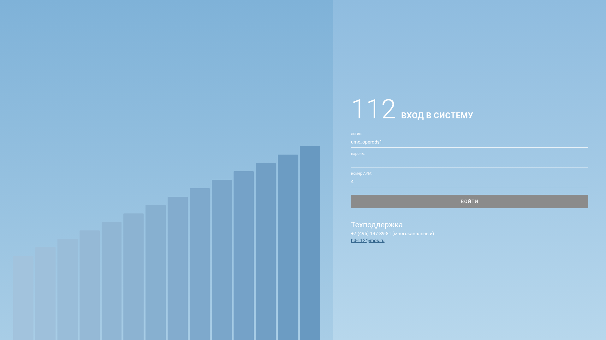
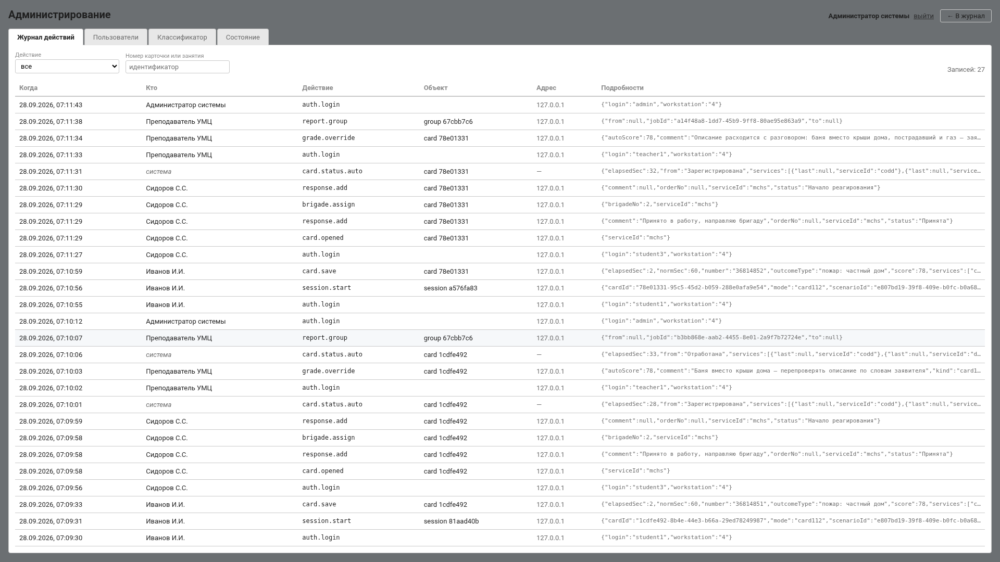

<div class="титул" markdown="1">

<p class="надзаголовок">Лидеры цифровой трансформации 2026 · Задача №9<br>
Департамент ГОЧСиПБ города Москвы</p>

# Тренажёр специалиста ДДС с использованием ИИ

**Руководство администратора**

Команда ELABS

Версия 1.0 от 20.10.2026

</div>

[TOC]

---

## 1. Кто такой администратор

Администратор отвечает за то, чтобы тренажёр был готов к занятию:
заведены учётные записи, загружен и активирован классификатор, заданы
параметры, включены или свёрнуты рабочие места. Администратор видит
оценки и разборы, но не ставит оценок и не ведёт занятий — это роль
преподавателя.

Учётная запись администратора на чистой установке — `admin`, пароль
`arm112`. Смените его после установки.

---

## 2. Вход



*Рис. 1. Экран входа. Роль и рабочее место определяет сервер по
учётной записи.*

На демонстрационном стенде (задан `DEMO_PASSWORD`, см. общее техническое
описание, §6.1) экран входа показывает учебные учётные записи списком
под заголовком «Учебные учётные записи» — по одной на роль и службу.
Вход — одним щелчком по записи. На рабочей установке `DEMO_PASSWORD`
не задают, и вход идёт по логину и паролю.

**Переключатель «Система 112»** на экране входа показывает, включено ли
рабочее место оператора 112. Кнопка «Включить 112» / «Выключить 112»
запрашивает логин и пароль администратора и меняет параметр `ui.op112`
без входа в систему. Так удобно перед занятием: показать экран входа
на проекторе и включить 112 тут же. Тот же параметр доступен в
«Параметрах».

Раздел администратора открывается ссылкой «администрирование» в верхней
панели. Вкладки: **Журнал действий**, **Пользователи**,
**Классификатор**, **Параметры**, **Состояние**.



*Рис. 2. Раздел администратора.*

---

## 3. Учётные записи и роли

### 3.1. Роли

| Роль | Что доступно |
|---|---|
| **Обучающийся** (курсант) | свои задания: учебные происшествия, экзамены, тренировки по частям; карточки, телефон, разбор, рекомендации, свои оценки |
| **Преподаватель** | учебный материал, группы, занятия, ход занятия, телефонный справочник, журнал вызовов и записи, веса оценки, аналитика, экспертная оценка |
| **Администратор** | всё, что описано в этом руководстве; оценки видит, но не ставит |

У курсанта, кроме роли, есть **рабочее место** (`duty`): диспетчер ДДС
своей службы или оператор 112. Оно определяет, какие задания к нему
приходят и какие действия пропускает сервер. Рабочее место назначают
администратор (любому курсанту) и преподаватель (своим курсантам);
смена действует сразу, без перевхода, и пишется в журнал действий.

### 3.2. Завести пользователя

Вкладка «Пользователи» → «Завести пользователя». Поля:

| Поле | Что указать |
|---|---|
| Логин | латиницей, уникальный |
| Пароль | задаётся при создании |
| ФИО | как будет показано преподавателю и в протоколах |
| Роль | Обучающийся / Преподаватель / Администратор |
| Служба | для диспетчера ДДС — его служба из справочника (окно «Добавьте службы»: Служба 101, Служба 104, Служба 103, ЦОДД, Мослифт, Деп. ЖКХ и другие) |
| Рабочее место | диспетчер ДДС или оператор 112 |
| Номер АРМ | номер рабочего места, как в карточке |

В списке пользователей видны служба, АРМ, число занятий и состояние;
у курсанта рабочее место меняется прямо в строке. Ссылка «отключить»
запрещает вход (история сохраняется), «включить» — возвращает.

### 3.3. Удалить пользователя

Если у записи есть история обучения, данные перед удалением копируются
в резервную таблицу `user_backups` и обезличиваются: оценки, карточки
и журнал действий остаются читаемыми для аналитики. Нельзя удалить
свою запись и последнего администратора.

### 3.4. Учебный набор

Учебный набор (`deploy/seed/залить.py`) заводит `teacher1`, операторов
`op01`…`op10` и диспетчеров `dds01`…`dds10` (две группы по пять
человек: Служба 101, Служба 104, Служба 103, ЦОДД, Мослифт / Деп. ЖКХ),
пароль у всех `arm112`. Без набора на чистой базе есть `admin`,
`teacher1` и `student1`…`student5`.

Группы (состав, кто в какой) формирует преподаватель на своей
странице; администратор видит их в списке пользователей.

---

## 4. Классификатор

Единый классификатор происшествий — таблица, по которой тренажёр
подбирает службы и выводит опросные карты. Вкладка «Классификатор»
показывает загруженные версии и активную.

* **Первая версия** импортируется автоматически при первом запуске
  стенда из `task/*.xlsx` и становится активной.
* **Новая версия** загружается командой на сервере (в контейнере
  `backend` или рядом с ним):
  `import_classifier <файл.xlsx> "<имя версии>"`; в списке она появится
  со своим именем, файлом, числом позиций и датой загрузки. Опросные
  карты для типов, у которых нет карт по кадрам рабочего места, выводятся
  из классификатора при активации.
* **«Сделать активной»** — все новые задания считаются по этой версии;
  уже выставленные оценки не пересчитываются: они зафиксировали
  справочник, действовавший в момент сохранения. Смена активной версии
  пишется в журнал (`classifier.activate`).
* **Разница версий и затронутые задания** — `GET
  /api/classifier/versions/{a}/diff/{b}` и `…/impact`: какие позиции
  изменились и у каких учебных заданий изменится эталон.

Вне стенда импорт: `cargo run --release --bin import_classifier --
<файл.xlsx> "<имя версии>"`, затем перезапуск сервера. На стенде:
`docker compose -f deploy/docker-compose.yml exec backend
/app/bin/import_classifier /app/task/<файл.xlsx> "<имя версии>"`.

В активной версии 1 283 позиции в 24 группах, 211 служб.

---

## 5. Параметры

Вкладка «Параметры» — список всех параметров с названием, подсказкой и
полем значения. Сохранение — по кнопке у параметра; значение вне
пределов сервер не принимает, интерфейс пишет «Нужно число» или
«Не сохранилось». Каждое изменение — в журнале (`setting.change`).

### 5.1. Рабочие места и телефон

| Параметр | Значение | Что меняет |
|---|---|---|
| Рабочее место оператора 112 (`ui.op112`) | 0 — свёрнуто (по умолчанию), 1 — показывать | Разделы, материал и учётные записи 112 появляются у преподавателя, курсантов и на экране входа. Код и данные 112 на месте всегда |
| IP-телефон диспетчера ДДС (`ui.phone`) | 1 — звонки бригаде и начальнику через IP-телефон на карточке; 0 — кнопками в карточке | |
| Запись разговоров IP-телефона (`phone.record`) | 1 — голос диспетчера сохраняется, преподаватель слушает разговор целиком; 0 — только текст реплик | |
| Входящий вызов звонит, с (`phone.ring_sec`) | 5–120, по умолчанию 20 | Через сколько входящий от старшего бригады становится пропущенным |
| Абонент снимает трубку через, с (`phone.answer_sec`) | 0–15, по умолчанию 2 | Длительность гудков исходящего |

Смена `ui.op112` и телефонных параметров применяется у пользователей
сразу: клиент перечитывает сведения о стенде.

### 5.2. Нормативы диспетчера ДДС

| Параметр | По умолчанию | Пределы |
|---|---|---|
| Норматив подтверждения ДДС (открыть карточку), с | 30 | 5–600 |
| Норматив первой записи ДДС, с | 180 | 10–3600 |
| Норматив завершения работ, ч | 48 | 1–720 |
| Норматив обновления статуса после доклада бригады, с | 30 | 5–600 |

Источник нормативов — памятка ДДС и ответ заказчика. Просроченные
карточки сторож переводит в «Не оповещено», а по истечении норматива
завершения — в «Не завершено».

### 5.3. Учебная бригада

Число бригад у службы (3, пределы 1–10) и шкала этапов от момента
назначения: выезд 20 с, путь 40 с, начало работ 20 с после прибытия,
работы 60 с; задержка доклада старшего 25 с. Пределы — 5–3600 с
(задержка — от 0). Для показа на занятии удобна короткая шкала; для
экзамена её можно растянуть.

### 5.4. Искусственный интеллект

| Параметр | Значение |
|---|---|
| Чем сверять описание курсанта (`analysis.engine`) | 0 — автоматически (кросс-энкодер, если подключён, иначе языковая модель), 1 — только кросс-энкодер, 2 — только языковая модель |
| Модель в разговоре с начальником (`chief.live_model`) | 1 — только с быстрой моделью (видеокарта); 0 — начальник переспрашивает по ключевым словам, модель разбирает доклад один раз после «Принял» |
| Живая речь заявителя (`applicant.live_model`) | 1 — только с быстрой моделью; 0 — фразы сценария |
| Порог аттестации, баллов | 70 (1–100) |
| Допуск прогноза, баллов; глубина истории; штраф регрессии | 10 (1–30); 5 (3–20); 0,1 (0–10) |
| Окно рекомендаций, разборов | 5 (2–20) |

### 5.5. Веса оценки

`weight.time`, `weight.statuses`, `weight.comments`, `weight.address`,
`weight.type_services`, `weight.completeness` — по 3, `weight.text` —
0 (замечания нейросети балл не меняют, пока преподаватель не решит
иначе). Пределы 0–5. Преподаватель меняет их на странице «Веса оценки»
с пересчётом «было → стало»; администратор может задать напрямую.

---

## 6. Журнал действий

Вкладка «Журнал действий» — кто, когда и что изменил. Фильтры по
действию и по объекту. Записываются, в частности: заведение и удаление
учётных записей (`user.create`, `user.delete`), смена рабочего места,
активация версии классификатора (`classifier.activate`), изменение
параметров (`setting.change` с ключом) и весов (`grading.weights`),
экспертная оценка (`grade.override`), вердикт преподавателя по
замечанию нейросети (`analysis.verdict`).

`GET /api/admin/audit` отдаёт журнал для внешней системы.

---

## 7. Состояние системы

Вкладка «Состояние» обновляется сама и показывает: база данных
(отвечает / недоступна), время работы сервера, адаптеры моделей
(`http` — модель подключена, `mock` — заглушка), открытых каналов
событий, задач в очереди и в работе (фоновые задачи: сторож нормативов,
доклады бригад, запросы к модели), версия сервера.

То же — `GET /api/admin/health`. Проверка всего стенда снаружи —
`deploy/check.sh https://<адрес>`.

---

## 8. Обслуживание

### 8.1. Резервные копии

Сервер делает копию базы ежесуточно в том `backups`; хранится
`BACKUP_KEEP_DAYS` дней (14). Копия вручную и восстановление:

```bash
cd deploy
docker compose exec -T db pg_dump -U arm112 -Fc arm112 > ../arm112-$(date +%F).dump
docker compose exec -T db pg_restore -U arm112 -d arm112 -c < ../arm112-2026-10-20.dump
```

Перед заливкой учебного набора (`seed/залить.py`) копия обязательна:
скрипт очищает учебные данные.

### 8.2. Обновление

```bash
git pull && deploy/up.sh      # пересобирает только изменившееся
docker compose -f deploy/docker-compose.yml ps
```

Миграции схемы сервер накатывает сам при старте. Данные в томе
`db-data` сохраняются.

### 8.3. Журналы и неисправности

```bash
docker compose -f deploy/docker-compose.yml logs backend   # сервер
docker compose -f deploy/docker-compose.yml logs voice     # голос
docker compose -f deploy/docker-compose.yml logs model     # модель
```

Таблица признаков и действий — общее техническое описание, §7. Коротко:
нет модели — тренажёр работает на заглушке (нет черновиков по
описанию, сводки и анализа текста); нет голоса — разговор текстом;
микрофон только по HTTPS; классификатор не загружен — нет опросных карт
и подбора служб.

### 8.4. Безопасность

Наружу открыт один порт HTTPS; сервер, база и модели видны только в
сети compose. Пароли хранятся хэшами argon2, вход — токены JWT со сроком
`JWT_TTL_HOURS`. Разграничение ролей и рабочих мест проверяется на
сервере при каждом запросе. В рабочей установке `DEMO_PASSWORD` не
задавать и сменить пароль `admin`.

---

## 9. Подготовка к занятию: контрольный список

1. `deploy/check.sh https://<адрес>` — все проверки зелёные.
2. Вкладка «Состояние»: база отвечает, адаптер `http`, если нужна модель.
3. Заведены курсанты с нужной службой и рабочим местом; преподаватель
   собрал группу.
4. Параметры: `ui.op112` по плану занятия; `ui.phone = 1`,
   `phone.record = 1`, если преподаватель будет слушать записи; шкала
   бригады под длительность занятия.
5. Если используется голос: рабочие места открывают стенд по `https://`,
   микрофон разрешён в браузере.
6. Свежая копия базы.
