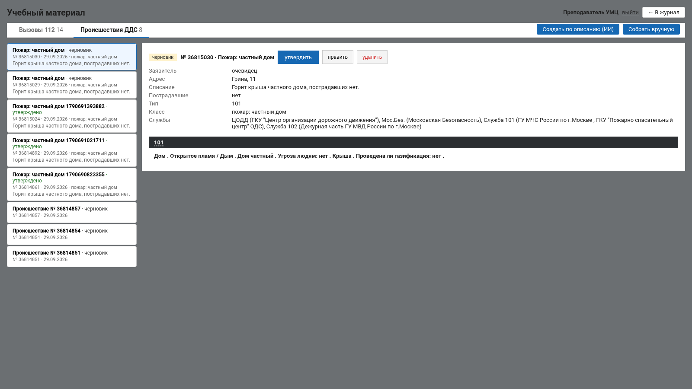
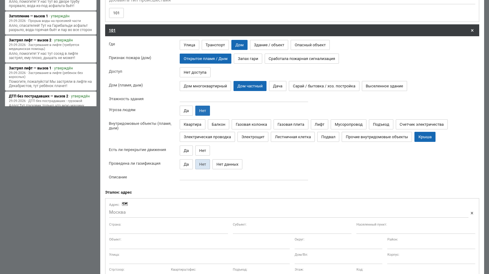
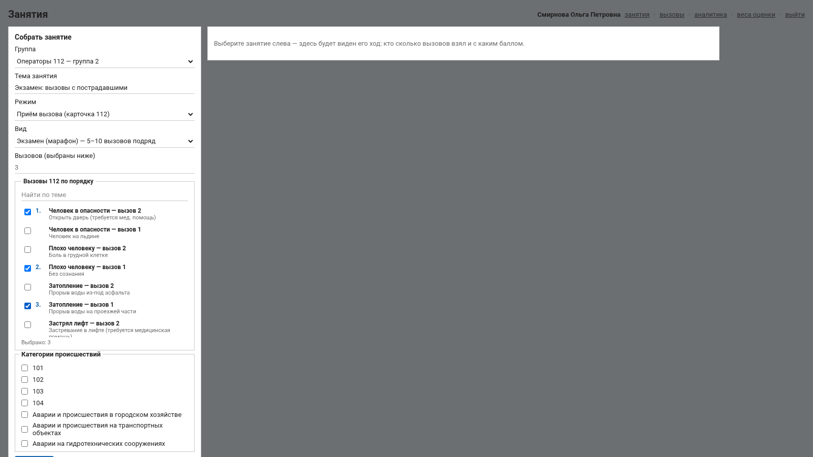

<div class="титул" markdown="1">

<p class="надзаголовок">Лидеры цифровой трансформации 2026 · Задача №9<br>
Департамент ГОЧСиПБ города Москвы</p>

# Тренажёр специалиста ДДС с использованием ИИ

**Руководство преподавателя**

Команда ELABS

Версия 1.0 от 20.10.2026

</div>

[TOC]

---

## 1. Что делает преподаватель

Преподаватель готовит учебный материал, собирает группы, проводит
занятия, следит за ходом работы по местам, слушает записи разговоров,
разбирает попытки и ставит экспертную оценку, смотрит аналитику. Схема
обучения, под которую сделан тренажёр:

```
преподаватель ──► задание ──► обучаемый (ДДС) ──► результат ──► рекомендации
     ИИ       ──► задание ──►    обучаемый     ──► результат ──► следующее задание
```

Вторая строка работает без преподавателя: обучаемый сам получает
происшествие от ИИ, а после разбора — следующее задание под своё
слабое место. Преподаватель видит всё это в журнале и аналитике.

Учётная запись учебного набора — `teacher1`, пароль `arm112`. На
демонстрационном стенде вход — одним щелчком по записи «Преподаватель»
на экране входа.

Ссылки преподавателя в верхней панели: **занятия**, **вызовы** (страница
«Учебный материал»), **аналитика**, **веса оценки**, **журнал**; группы
и курсанты — в «Занятиях».

---

## 2. Учебный материал

Раздел «Учебный материал», вкладка «Список происшествий ДДС» (и, если
администратор включил систему 112, «Список вызовов»). Происшествие ДДС —
готовая карточка 112: адрес, заявитель, описание, тип с ответами
опросной карты, службы. Диспетчер получает её так же, как боевую
карточку.

До **утверждения** материал не виден ни курсантам, ни при составлении
занятия. Преподаватель — конечный валидатор.

### 2.1. Происшествие от ИИ

Кнопка «Происшествие от ИИ» (она же на главном экране). Достаточно
выбрать **службу** и указать, **сколько происшествий** собрать. Система:

1. берёт из классификатора позицию, по которой выбранная служба
   реагирует, и восстанавливает ответы опросной карты, ведущие к ней;
2. проверяет тем же классификатором, что служба действительно в списке
   оповещения;
3. берёт адрес из учебного набора (реальные улицы Москвы без привязки к
   событиям), составное ФИО заявителя;
4. языковая модель пишет текст карточки — первую фразу заявителя и
   описание — под уже проверенные признаки.

Службы модель не выбирает никогда: их считает классификатор. Без
модели происшествие всё равно собирается — описание из ответов карты.
На процессоре модель пишет текст до двух минут на происшествие, на
видеокарте — секунды.

Готовое происшествие появляется в списке черновиком: откройте, проверьте,
при необходимости поправьте и **утвердите**.



*Рис. 1. Происшествие ДДС в учебном материале: поля карточки, тип и
признаки, службы, посчитанные классификатором.*

### 2.2. По описанию (ИИ)

«Создать по описанию (ИИ)»: напишите словами, что произошло («задымление
мусоропровода, дым в подъезде, пострадавших нет»), укажите тему. Модель
готовит черновик по строгой схеме: признаки — только из словаря
опросной карты, эталон служб пересчитывает классификатор.


*Рис. 2. Подготовка по описанию: черновик модели, который преподаватель
правит и утверждает.*

Черновик дорабатывается перепиской с моделью: «поменяй ФИО», «сделай
первую фразу короче». После правки показывается, что изменилось
фактически, эталон пересчитывается. Ваши поправки подаются модели при
следующей правке того же материала.

### 2.3. Вручную

«Собрать вручную» — форма из тех же полей, что карточка 112: тема,
адрес, заявитель (ФИО, телефон, статус), описание со слов заявителя,
пострадавшие, тип происшествия и признаки опросной карты, норматив
заполнения. Службы подбирает классификатор при сохранении; «Службы
сверх подобранных классификатором» можно добавить поиском («Мослифт»,
«скорая», «Щукино»). Для вызова 112 добавляются скрытые факты —
вопрос оператора и ответ заявителя, которые курсант должен выяснить.



*Рис. 3. Сборка материала вручную.*

### 2.4. Утверждение, правка, удаление

В карточке материала: «Утвердить» — после сохранения. Выданное в
занятии происшествие править и удалять нельзя: по нему есть работа
курсантов. Занятие выдаёт курсантам копию карточки.

---

## 3. Группы и рабочие места

В «Занятиях» — «Курсанты группы»: состав группы, у каждого служба и
рабочее место. Рабочее место курсанта (диспетчер ДДС своей службы или,
при включённом 112, оператор) преподаватель меняет своим курсантам;
смена действует сразу и пишется в журнал. Подсказка «В этом режиме
заниматься некому — назначьте рабочее место ниже» появляется, если в
группе нет курсантов с нужным рабочим местом.

Учебный набор: группа 1 — `dds01`…`dds05` (Служба 101, Служба 104,
Служба 103, ЦОДД, Мослифт), группа 2 — `dds06`…`dds10` (…, Деп. ЖКХ).

---

## 4. Занятия

### 4.1. Виды занятий

| Вид | Что это | Правила |
|---|---|---|
| **Обычное занятие** | происшествия по выбранным категориям или поимённо | разбор сразу после каждого; карточки поступают потоком с заданным интервалом |
| **Экзамен** («Марафон») | 5–10 происшествий | строго по порядку, одна попытка; разбор и балл открываются после последнего |
| **Тренировка по частям** («Блиц») | 3–10 коротких заданий на один сегмент | у ДДС сегмент — работа со статусами по докладам бригады; в балл идут только проверки сегмента, время не оценивается |

### 4.2. Собрать занятие

«Собрать занятие»: тема, группа, режим («Работа со статусами (ДДС)»
или, при включённом 112, «Приём вызова (карточка 112)»), вид занятия,
категории происшествий (ничего не выбрано — подойдут любые) или
поимённый выбор материала («Происшествия ДДС по порядку», поиск по
теме), «Новая карточка каждой службе — раз в, секунд» — интервал
потока. Карточки ДДС придут только диспетчерам — по их службам.



*Рис. 4. Поимённый выбор материала для занятия.*

Занятие создаётся, затем **запускается** (карточки начинают поступать),
по окончании **завершается**. В списке занятий — состояние, роздано
вызовов, пройдено, разобрано, средний балл.


*Рис. 5. Занятия: создание, запуск, ход по местам, протокол.*

### 4.3. Ход занятия по местам

Страница идущего занятия: время, число мест, блок «Диспетчеры ДДС»
(и «Операторы 112»). У каждого места — ФИО, текущая карточка, крупный
таймер против норматива (30 с на открытие, 3 мин на первую запись),
отметки «Открыл», «Ответил», «Сохранил», «Сдал», ход заполнения, кто
опаздывает, «не оповещено», отказы. Обновление раз в 2,5 с. Режим
проектора — для большого экрана в классе.

### 4.4. Протокол

«Отчёт» по занятию — итоговый протокол по каждому курсанту: задания,
балл, время, грубые ошибки, экспертная оценка. Отдаётся также в JSON и
CSV для внешней системы.

---

## 5. Телефонный справочник ДДС и IP-телефон

На карточке у диспетчера работает программная эмуляция IP-телефона:
свой внутренний номер, телефонная книга, входящие с АОН, удержание,
журнал вызовов. Собеседники — старший бригады, вышестоящий начальник,
заявитель — отвечают голосом синтеза; второй человек на линии не нужен.

**Телефонный справочник службы формирует преподаватель.** В справочнике
до десяти номеров на службу: руководитель организации, начальник отдела
реагирования, начальник аварийной бригады, специалист аварийной
бригады, заявитель. Позвонить заявителю диспетчер может только если
преподаватель включил его в справочник. Справочник правится на странице
**«телефоны ДДС»** в верхнем меню: выбрать службу, «+ Абонент» или
«+ Заявитель», роль, номер и подпись (должность, ФИО), «Сохранить»;
«По умолчанию» возвращает исходный набор. Номер заявителя в справочник
не пишется — диспетчер набирает его из карточки (АОН).

Параметры телефона (включён ли телефон, запись разговора, сколько
звонит входящий, через сколько снимают трубку) задаёт администратор.

---

## 6. Журнал вызовов и записи разговоров

Откройте карточку курсанта из журнала — под карточкой блок **«Журнал
IP-телефона»**: по каждому вызову направление, номер и АОН, кто звонил,
время, исход (принят, пропущен, сброшен), реплики по строкам. Если
администратор включил запись (`phone.record = 1`), доступна запись
разговора целиком в WAV — её слушает преподаватель и сам диспетчер.
Без голосового сервера сохраняется текст реплик.

Пропущенный входящий от старшего бригады — повод для разговора с
курсантом: доклад при этом всё равно попал в список бригады, но
диспетчер его не слышал.

---

## 7. Разбор и экспертная оценка

### 7.1. Что проверяет разбор ДДС

| Замечание | Смысл |
|---|---|
| статус раньше доклада | «не по факту» — поставил, не дождавшись доклада бригады |
| доклад без статуса | 112 и соседние ДДС не видят хода работ |
| принята, бригада не назначена | на место никто не выехал |
| статус позже доклада сверх норматива | в карточке устаревшая картина |
| карточка открыта позже 30 с | норматив открытия |
| первая запись позже 3 мин или без текста | норматив первой записи |
| «Не принята» / «Отказ» без причины | сервер не принимает, в разборе отмечается |

Доклад начальнику разбирается отдельным блоком: по каждому сведению
(что, где, пострадавшие, кого оповестили, бригада и этап) — «доложено»,
«не доложено» или «доложено неверно» с дословной фразой диспетчера.
Балл он не меняет — решение за преподавателем.

### 7.2. Анализ текста нейросетью

Комментарии диспетчера к статусам модель сверяет с карточкой и
докладами бригады. Каждое замечание — с цитатой, которую проверяет код:
нет цитаты в тексте — замечания нет. Блок «Анализ текста (нейросеть)»
в разборе попытки: преподаватель **подтверждает или отклоняет** каждое
замечание («Повторить анализ» — заново). Модели нет — блок помечен
«модель недоступна». Балл модель не меняет: вес «понятность текста» по
умолчанию 0.


*Рис. 6. Замечания модели с цитатами и вердикт преподавателя.*

### 7.3. Экспертная оценка

В «Разборе попытки» — «История попыток» по карточке и кнопка
«Поставить оценку»: экспертный балл 0–100 и комментарий курсанту.
Автоматический балл не переписывается, оба показываются рядом; оценка
пишется в журнал действий. «Изменить оценку» — поправить.


*Рис. 7. Экспертная оценка рядом с автоматической.*

---

## 8. Веса оценки

Страница «Веса оценки»: семь групп проверок с ползунками 0–5.

| Группа | Что входит |
|---|---|
| Время | 30 с на открытие, 3 мин на первую запись |
| Порядок статусов | статусы по порядку и по докладам бригады, бригада направлена |
| Комментарии | первая запись со статусом и текстом, мотивировка отказа |
| Адрес | улица, дом и прочие поля (для 112); похожая улица — критичная ошибка, балл не выше 40 |
| Тип происшествия и службы | тип, требуемые и лишние службы (для 112) |
| Полнота карточки и вопросы | признаки опросной карты, «сказал ↔ заполнил» (для 112) |
| Понятность текста | замечания нейросети, не отклонённые преподавателем; по умолчанию 0 |

Балл = Σ (вес группы × зачёт проверки) / Σ весов. Ползунки пересчитывают
баллы всех сданных попыток до сохранения: видно «средний балл было →
стало», сколько попыток изменят балл, разбивку по ученикам.

---

## 9. Аналитика

«Аналитика» — по группе и по ученику, отдельно для ДДС и 112:

* средний балл, динамика балла по занятиям;
* время против норматива: каждая точка — занятие, красные выше черты;
* лидеры и отстающие — и на чём;
* типичные ошибки группы, тепловая карта «ученик × группа проверок»;
* прогноз против факта и ошибка прогноза;
* словесная сводка по группе — её формулирует модель, но числа подаются
  уже посчитанными (на процессоре около минуты).


*Рис. 8. Аналитика по группе.*

---

## 10. Прогноз и рекомендации

**Прогноз** результата фиксируется до начала задания и задним числом не
меняется; факт проставляется после разбора. Пока пар «прогноз — факт»
меньше 30, прогноз равен среднему баллу курсанта. Достоверность —
средняя ошибка и доля попаданий в допуск (±10 баллов, параметр
администратора).

**Рекомендации** после разбора: система ищет повторяющиеся ошибки —
одно поле с тем же замечанием в последних пяти разборах (повтор не
меньше двух раз, открытых рекомендаций не больше трёх). Текст собирается
из замечаний разбора, модель его не пишет. В следующем разборе, где
ошибка могла повториться, ставится вердикт: ушла или нет. В аналитике —
доля сработавших рекомендаций рядом с базовой линией.

**Следующее задание от ИИ.** После разбора курсант нажимает «Следующее
задание от ИИ»: система собирает новое происшествие его службы (тип и
службы — классификатор, текст — модель) и выдаёт без участия
преподавателя; на карточке видно, какую рекомендацию оно отрабатывает.
Исполнение рекомендаций диспетчеров преподаватель видит в аналитике по
ученикам, вкладка ДДС: блок «Рекомендации диспетчерам ДДС и их
исполнение» — доля сработавших рядом с базовой линией.

---

## 11. Занятие за 10 минут: порядок действий

1. Учебный материал → «Происшествие от ИИ» → служба и количество →
   проверить и утвердить (или выбрать готовое из учебного набора).
2. Занятия → «Собрать занятие»: группа, режим «Работа со статусами
   (ДДС)», обычное занятие, материал поимённо, интервал карточек.
3. Запустить. Открыть «Ход занятия по местам» (режим проектора).
4. По завершении — «Завершить», открыть протокол.
5. Журнал → карточка курсанта: журнал IP-телефона и запись, разбор
   попытки, вердикты по замечаниям нейросети, экспертная оценка.
6. Аналитика группы — на чём ошибаются; при необходимости — веса оценки.
