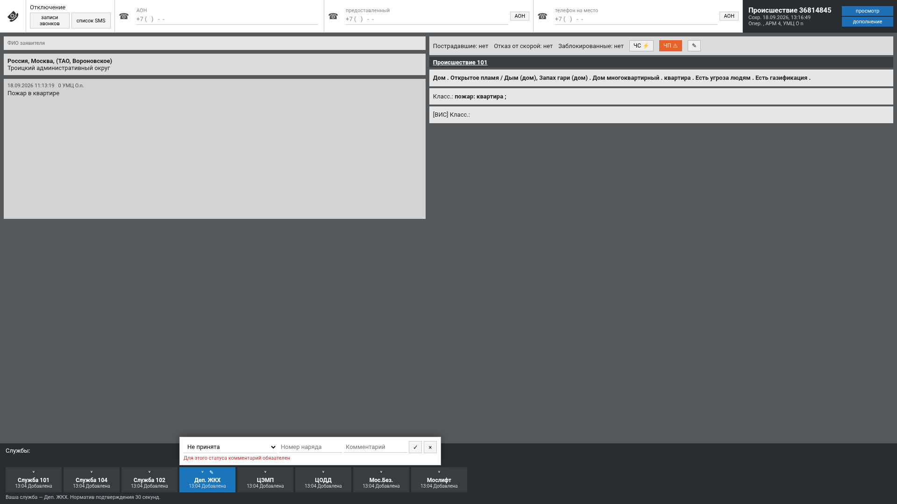
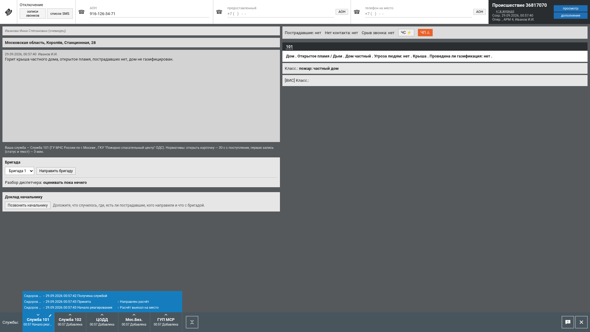

Лидеры цифровой трансформации 2026 · Задача №9 
Департамент ГОЧСиПБ города Москвы

# Тренажёр специалиста ДДС с использованием ИИ

**Руководство обучаемого**

Диспетчер ДДС · оператор 112

Команда ELABS

Версия 1.0 от 20.10.2026

[TOC]

---

## 1. Что вас ждёт

Вы работаете на рабочем месте диспетчера дежурно-диспетчерской службы:
принимаете карточки происшествий своей службы, направляете бригаду,
ведёте статусы реагирования по докладам старшего бригады, докладываете
начальнику. Всё, как на боевом рабочем месте, только происшествия
учебные, а бригада и собеседники — программные.

Задания вам выдаёт преподаватель на занятии или искусственный интеллект
по вашему нажатию. После каждого задания вы сразу видите разбор: что
сделано верно, что нет, во что ошибка обошлась бы на практике, и
рекомендации, над чем поработать.

Нужен компьютер с браузером, наушники или гарнитура с микрофоном
(говорить можно и текстом).

---

## 2. Вход

Откройте адрес тренажёра, который назвал преподаватель, —
`https://<адрес>/`. Браузер может один раз предупредить о сертификате —
подтвердите. На учебном стенде экран входа показывает учётные записи
списком: щёлкните по своей — например, «Диспетчер · Служба 101» — и вы
на рабочем месте. На рабочей установке введите логин и пароль, которые
выдал преподаватель.

*Рис. 1. Экран входа.*

Адрес должен начинаться с `https://`: иначе браузер не даст микрофон,
и говорить придётся текстом.

---

## 3. Рабочее место диспетчера ДДС

*Рис. 2. Разделы диспетчера ДДС и лента происшествий службы.*

**Мои задания** — три раздела:

| Раздел | Что в нём |
|---|---|
| Учебные происшествия | задания занятия; разбор сразу после каждого |
| Экзамены | 5–10 происшествий строго по порядку, одна попытка; балл — после окончания экзамена |
| Тренировка по частям | короткие задания на работу со статусами; в балл идут только они, время не оценивается |

В строке задания — дата выдачи, тема, статус цветом и балл. Законченное
задание открывается только на разбор: пройти его повторно нельзя.
«Заданий пока нет — их выдаёт преподаватель на занятии» — ждите начала
занятия или возьмите задание у ИИ (раздел 10).

**Лента службы** — происшествия, выданные вашей службе. Несколько
карточек могут идти одновременно: пока вы заняты одной, время идёт и у
остальных.

Кнопка **«?»** рядом с вашим именем в ленте и **«Подсказки»** в полосе
служб карточки включают тур по рабочему месту: окна обводятся и
нумеруются в порядке памятки ДДС, у текущего — что это и когда им
пользоваться. «Далее» и «Назад» листают, Esc или «Закрыть» выключают.

---

## 4. Нормативы времени

| Норматив | Срок | Откуда |
|---|---|---|
| Открыть карточку | 30 с с момента появления в ленте | памятка ДДС |
| Первая запись — статус и текст | 3 мин | ответ заказчика |

Таймер виден на карточке. Просрочка не блокирует работу, но попадает в
разбор; карточку, не открытую в срок, система помечает «Не оповещено».

---

## 5. Карточка происшествия

*Рис. 3. Карточка ДДС: поля 112 только для чтения, свои статусы и
комментарии.*

Поля, заполненные оператором 112 (адрес, заявитель, описание, тип,
пострадавшие), **не редактируются** — читайте их. Ваше — блок «Службы и
статусы реагирования», бригада, телефон, доклад начальнику.

### 5.1. «Принята» или «Не принята»

Первое действие — принять карточку или отказаться. «Не принята» — только
с причиной в комментарии: без текста сервер запись не примет
(«Для этого статуса комментарий обязателен»).

*Рис. 4. Отказ без причины не проходит.*

### 5.2. Статусы по порядку

«Принята» → «Начало реагирования» → «Прибытие» → «Проведение работ» →
«Работы завершены» или «Отказ от выполнения работ» (с причиной).
Предлагаются только допустимые следующие статусы, порядок проверяет
сервер.

*Рис. 5. Выбор статуса: только допустимые по порядку.*

**Главное правило — статус ставится по факту**, то есть после доклада
старшего бригады о наступившем этапе. Статус, поставленный раньше
доклада, разбор отмечает как «не по факту». Доклад без статуса — тоже
замечание: служба 112 и соседние ДДС не видят хода работ. Норматив
обновления статуса после доклада — 30 с.

К статусу пишите комментарий: что сделано, кому передано. Комментарии
читает нейросеть и сверяет с карточкой и докладами.

*Рис. 6. История статусов и комментариев.*

---

## 6. Бригада

После «Принята» направьте бригаду: в панели «Бригада службы» выберите
одну из учебных бригад. С этого момента идёт шкала работ: выезд,
прибытие, начало работ, завершение. Старший бригады докладывает о
каждом этапе с задержкой — кто позвонил старшему раньше, узнаёт раньше.
Доклад называет только этап («прибыли на место»).

*Рис. 7. Панель бригады: назначение, звонок старшему, доклады.*

Если бригаду не назначить, в разборе будет «принята, бригада не
назначена — на место никто не выехал».

---

## 7. IP-телефон

Телефон открывается **зелёным кружком с трубкой** в правом нижнем углу
карточки и закрывается крестиком, Esc или тем же кружком; закрытое окно
разговор не прерывает. Когда звонят, кружок мигает оранжевым с
надписью «входящий», и телефон открывается сам.
На нём — ваш внутренний номер и состояние линии.

| Действие | Как |
|---|---|
| Позвонить | «Телефонная книга» → абонент, или «Набрать номер». Гудки — пока абонент не снимет трубку |
| Ответить на входящий | «Входящий · АОН …» — звонит старший бригады; примите, пока звонит, иначе вызов станет пропущенным (его доклад всё равно будет в списке бригады) |
| Говорить | нажмите кнопку и говорите, нажмите ещё раз — фраза уйдёт собеседнику; или «Сказать текстом…» |
| Удержание, отбой | «Удержание», «Положить трубку»; если звонят во время разговора — «Вторая линия», ответите после |
| Журнал | вкладка «Журнал вызовов»: кто кому звонил, когда, исход, реплики; запись разговора, если включена |

В телефонной книге — справочник вашей службы, который составил
преподаватель (до десяти номеров): начальник и специалист аварийной
бригады, начальник отдела реагирования, руководитель организации. Если
преподаватель включил в справочник заявителя, наберите номер заявителя
из карточки — ответит заявитель и расскажет то, что сообщил в 112.
Без этой записи номер заявителя «не обслуживается».

Собеседники отвечают голосом. Если голос не подключён, в телефоне
надпись «Голос не подключён — собеседник отвечает текстом». «Не
расслышано — повторите» — скажите ближе к микрофону или текстом.

---

## 8. Доклад начальнику

Когда работы идут, доложите вышестоящему начальнику — из телефонной книги
или кнопкой «Позвонить начальнику». Доложите: что случилось, где,
пострадавшие, кого оповестили, какая бригада и на каком этапе.
Начальник переспросит о каждом сведении, которого не услышал или которое
расходится с карточкой, и скажет «Принял». Говорить можно голосом или
текстом.

*Рис. 8. Звонок вышестоящему начальнику.*

В разборе доклад разбирается по каждому сведению: «доложено», «не
доложено», «доложено неверно» — с вашей дословной фразой.

---

## 9. «Работы завершены» и разбор

После доклада старшего о завершении поставьте «Работы завершены» — на
этом задание заканчивается, и открывается **разбор**:

* замечания с ценой ошибки: статусы по факту, бригада, нормативы,
  комментарии;
* разбор доклада начальнику;
* «Анализ текста (нейросеть)» — что в ваших комментариях расходится с
  карточкой и докладами, с цитатами; преподаватель подтверждает или
  отклоняет каждое замечание;
* прогноз, который система сделала до задания, и факт;
* балл 0–100 (в экзамене — после окончания экзамена);
* **рекомендации** — повторяющиеся ошибки по последним разборам, над
  чем поработать; в следующем разборе система отметит, ушла ли ошибка.

*Рис. 9. Разбор попытки: автоматический балл, экспертная оценка
преподавателя, рекомендации.*

Преподаватель может поставить свою оценку с комментарием — она
показывается рядом с автоматической.

---

## 10. Задания от ИИ

Преподаватель не нужен, чтобы тренироваться:

* **«Новое происшествие от ИИ»** в ленте — система собирает происшествие
  для вашей службы (тип и службы — по классификатору, текст — модель) и
  кладёт его в ленту; нормативы идут как обычно. Пока готовится —
  «ИИ готовит происшествие…», на процессоре до двух минут; повторное
  нажатие второе не ставит.
* **«Следующее задание от ИИ»** в разборе — новое происшествие
  вашей службы для отработки рекомендации; следующий разбор покажет,
  ушла ли ошибка.

Разные обучаемые получают разные происшествия: у каждого своя служба
и своя история ошибок.

---

## 11. Оператор 112 (если администратор включил систему 112)

Рабочее место оператора 112 по умолчанию свёрнуто. Если преподаватель
назначил вам это рабочее место и администратор включил систему 112,
разделы те же — «Учебные вызовы», «Экзамены», «Тренировка по частям», —
а работа такая:

1. Откройте выданный вызов. Заявитель говорит первую фразу.
2. **Расспрашивайте**: вопросами из списка, своими словами или голосом.
   Разбор отличает выясненное от угаданного: верное значение в карточке,
   о котором вы не спросили, — ошибка «угадал, а не выяснил».
3. Заполняйте карточку 112: адрес, заявитель, тип происшествия (можно
   несколько) и опросную карту — вопросы появляются по мере ответов.
4. Службы подбирает классификатор по признакам; добавить вручную — окно
   «Добавьте службы».
5. Сохраните карточку в норматив времени — и смотрите разбор.

*Рис. 10. Карточка 112 и разговор с заявителем.*

*Рис. 11. Разбор вызова 112: «выяснил или угадал», службы, прогноз.*

---

## 12. Если что-то не так

| Что видите | Что делать |
|---|---|
| Кнопка микрофона неактивна, «Микрофон браузер даёт только по HTTPS» | Откройте адрес с `https://` |
| «Нет доступа к микрофону — говорите текстом» | Разрешите микрофон для сайта в браузере или говорите текстом |
| «Не расслышано — повторите» | Повторите ближе к микрофону или введите текстом |
| «Голос не подключён — собеседник отвечает текстом» | Голосовой сервер не включён — работайте текстом |
| «Нет связи с сервером» | Подождите: соединение восстановится само; введённое не теряется. Если нет — скажите преподавателю |
| «Для этого статуса комментарий обязателен» | «Не принята» и «Отказ» — только с причиной |
| Статус не предлагается | Он не следующий по порядку; смотрите историю статусов |
| Пропущенный вызов старшего бригады | Его доклад в списке бригады; в следующий раз отвечайте, пока звонит |
| Карточка «Не оповещено» | Не открыта за 30 с — попадёт в разбор; откройте и работайте |
