# Тренажёр оператора ДДС города Москвы

**Сопроводительная документация**

Задача №9 Департамента по делам гражданской обороны, чрезвычайным ситуациям
и пожарной безопасности города Москвы. Лидеры цифровой трансформации, 2026.
Команда ELABS.

---

## 1. Что это и для кого

Тренажёр учит двух специалистов, от которых зависит, приедет ли помощь:

* **оператора 112** — принять вызов, расспросить заявителя, заполнить
  карточку происшествия, определить тип и оповестить нужные службы;
* **диспетчера ДДС** — принять карточку своей службы, назначить бригаду
  и вести статусы реагирования по докладам старшего до конца работ.

Курсант работает в интерфейсе, повторяющем рабочее место ПОВ-112
(АРМ-112): те же экраны, поля, опросные карты и окно выбора служб.
Преподаватель готовит учебные вызовы, ведёт занятия, экзамены и
тренировки по частям, смотрит аналитику и ставит экспертную оценку.
Администратор управляет версиями классификатора, учётными записями и
параметрами.

После каждого вызова курсант сразу получает разбор: что заполнено верно,
что нет и во что каждая ошибка обошлась бы на практике. Главное отличие
тренажёра от простой проверки полей: он **отличает выясненное от
угаданного**. Верное значение, о котором заявителя не спросили, считается
ошибкой. Оператор, который угадывает тип происшествия по первой фразе,
ошибётся, как только вызов окажется нетипичным. На данных стенда доля
угаданных ответов составила 38 %.


*Рис. 1. Вход в тренажёр. Одна учётная запись, роль и рабочее место
определяются на сервере.*

---

## 2. Как устроено

### 2.1. Состав

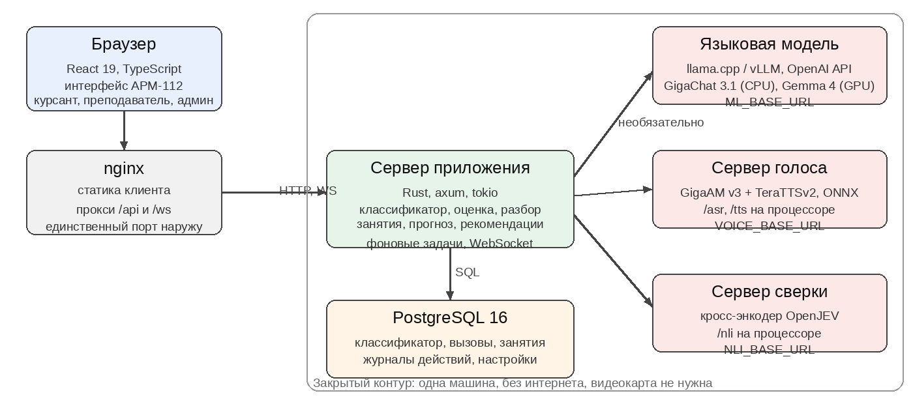

*Рис. 2. Компоненты тренажёра. Всё работает на одной машине без выхода
в интернет; нейросетевые сервисы необязательны.*

| Компонент | Технология | Назначение |
|---|---|---|
| Веб-клиент | React 19, TypeScript, Vite | интерфейс АРМ-112 и учебный слой |
| Сервер приложения | Rust, axum, tokio | API, домен, оценка, фоновые задачи |
| Хранилище | PostgreSQL 16 | классификатор, вызовы, занятия, журналы, настройки |
| Языковая модель | GigaChat 3.1 10B-A1.8B на llama.cpp | подготовка учебных вызовов, правка по переписке, сводки, анализ текста курсанта |
| Голос | GigaAM v3 (распознавание) и TeraTTSv2 (синтез), ONNX на процессоре | разговоры голосом: заявитель, старший бригады, начальник |
| Сверка описания | кросс-энкодер OpenJEV (Qwen3.5, 2B или 4B), PyTorch на процессоре | сверка описания курсанта с фактами вызова |

Объём кода: 15 848 строк Rust в 63 файлах, 5 673 строки TypeScript
в 49 файлах, 28 миграций схемы базы.

### 2.2. Сервер приложения

```
api/        HTTP-обработчики, схема OpenAPI
domain/     классификатор, статусы, оценка, бригада, прогноз, рекомендации
ingest/     импорт классификатора и билетов, вывод опросных карт
reports/    отчёты, прогноз и рекомендации над данными базы
jobs/       фоновые задачи: сторож нормативов, доклады бригад, очередь модели
ml/         адаптеры моделей: HTTP-сервер модели, голос, сверка, заглушка
```

Доменный слой не знает ни о HTTP, ни о моделях: классификатор, оценка,
разбор ДДС, прогноз и рекомендации — чистые функции над данными. Поэтому
все 400 серверных проверок выполняются без поднятия модели; там, где
важен её ответ, работает подставная.

Описание API машиночитаемо (OpenAPI, utoipa). Отдельная проверка читает
список маршрутов из исходного кода и падает при расхождении со схемой.

### 2.3. Клиент

Слоистая раскладка (Feature-Sliced Design): `shared` → `entities` →
`widgets` → `pages`. Состояние — zustand, стили — модули SCSS,
маршрутизация — HashRouter, поэтому собранный клиент отдаётся статикой
без настройки переписывания путей.

Канал событий WebSocket переподключается с возрастающей задержкой.
Канал ускоряет интерфейс, но не является источником истины: при его
отказе всё продолжает работать на обычных запросах.

### 2.4. Классификатор вместо нейросети

Единый классификатор происшествий (ЕКП) — таблица, где каждой комбинации
признаков соответствует ровно один ответ. Поэтому классификацию считает
не модель, а поиск по таблице:

```
ответы карты ──①──► признаки ──②──► позиция ЕКП ──③──► список оповещения
```

① Ответы опросной карты сопоставляются с признаками трёх уровней («где»,
«что именно», «уточнение»). ② По группе и признакам ищется позиция.
Если незаполненный уровень оставляет несколько позиций с разными исходами,
система не берёт первую попавшуюся, а называет варианты и просит
уточнить. ③ Позиция задаёт список оповещения. Службы, получающие лишь
копию карточки, отделяются от реагирующих: оценка не штрафует за то,
что оператор их не вызвал.

В активной версии классификатора 1 283 позиции в 24 группах, 134 593
строки матрицы оповещения, 60 служб-столбцов. Справочник служб — 211
служб, в том же порядке и с теми же названиями, что в окне «Добавьте
службы». Эталон учебного вызова не зависит от того, какая модель
загружена и загружена ли вообще.

### 2.5. Опросные карты

В списке «Что случилось?» 51 тип происшествия. Опросная карта есть
у 44 из них: 3 карты (101 — пожар, 104 — газ, «Взрыв») сняты
с кадров рабочего места дословно, 41 выведена из классификатора —
подписи вопросов взяты из заголовков столбцов, варианты из ячеек. У 7
типов («Внутренний звонок», «Нецелевой вызов» и подобных) карты нет:
это виды обращений, а не происшествия, и интерфейс так и пишет.

Карта растёт по мере ответов: варианты второго признака зависят от
первого, а вопрос появляется только при нужном ответе. Карты выводятся
при каждом запуске сервера и при активации новой версии классификатора,
поэтому смена версии не оставляет устаревших карт.

---

## 3. Роли и сценарии работы

| Роль | Что доступно |
|---|---|
| **Курсант — оператор 112** | разделы «Учебные вызовы», «Экзамены», «Тренировка по частям»; приём вызова, карточка 112, разбор, прогноз, рекомендации, свои оценки |
| **Курсант — диспетчер ДДС** | те же три раздела для ДДС и лента выданных происшествий; карточка ДДС, статусы, бригада, доклады, доклад начальнику, разбор |
| **Преподаватель** | учебный материал, группы, занятия, ход занятия по местам, веса оценки, аналитика, экспертная оценка |
| **Администратор** | версии классификатора, учётные записи, параметры, системные журналы; оценки видит, но не ставит |

Разграничение проверяется на сервере при каждом запросе; интерфейс
скрывает недоступные разделы, но не является средством защиты.

У курсанта одна учётная запись и профиль рабочего места (`users.duty`):
оператор 112 или диспетчер ДДС своей службы. Нарушение — отказ
`403 wrong_duty`. Профиль читается из базы на каждом запросе, поэтому
смена действует сразу, без перевхода. Профиль назначают администратор
(любому курсанту) и преподаватель (своим курсантам); каждая смена
пишется в журнал действий.

### 3.1. Оператор 112

```
вход → «Карточки для заполнения» → выданный вызов
                                  │
              разговор с заявителем ←→ заполнение карточки 112
                                  │
                       классификация → список оповещения
                                  │
                   разбор: оценка, прогноз, рекомендации
```

Оператор 112 видит только карточки для заполнения — три раздела:
«Учебные вызовы», «Экзамены» и «Тренировка по частям». В строке — дата
выдачи, тема, статус цветом и балл. Законченная карточка открывается
только на разбор: пройти её повторно нельзя, и это проверяет сервер.
В экзамене начать можно только следующий по порядку вызов, балл виден
после экзамена. Всё выдаёт преподаватель, сам курсант вызов не выбирает.

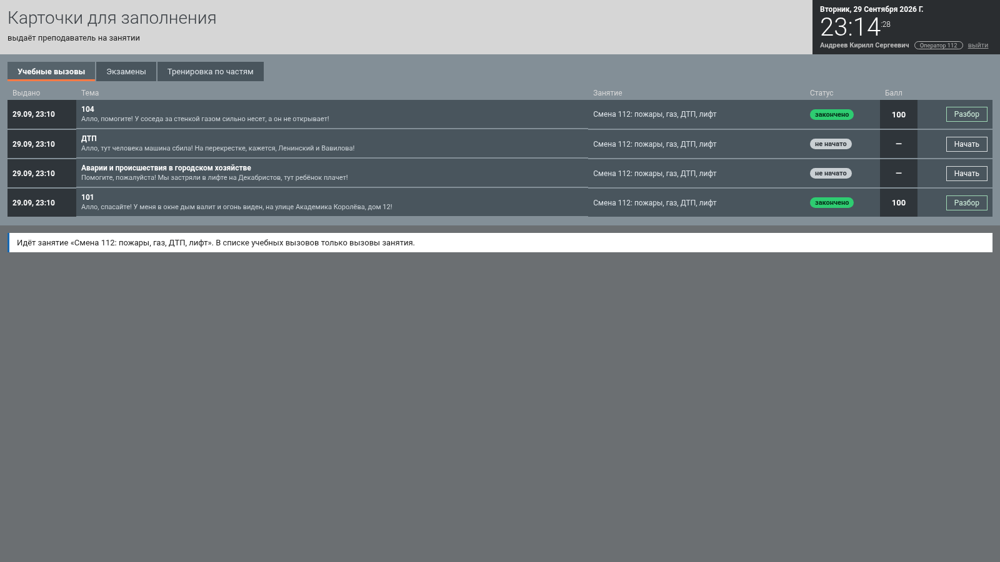

*Рис. 3. Разделы оператора 112: учебные вызовы, экзамены, тренировка
по частям.*

Курсант расспрашивает заявителя: вопросами из списка, своими словами
или голосом. Каждый ответ помечает факт выясненным — на этом держится
разбор «узнал или угадал». Ввод в карточку уходит на сервер пакетами;
правки в пределах одного окна сливаются, а не затирают друг друга,
при обрыве сети пакет повторяется.

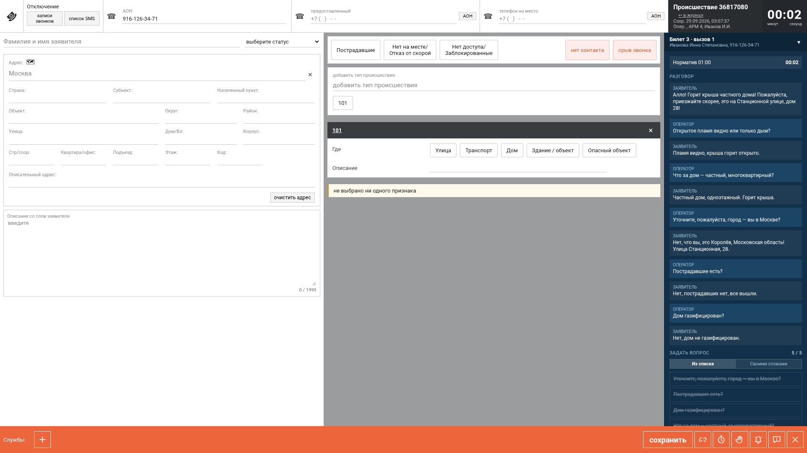

*Рис. 4. Карточка 112 и панель разговора с заявителем. Вопрос
из списка, своими словами или голосом.*

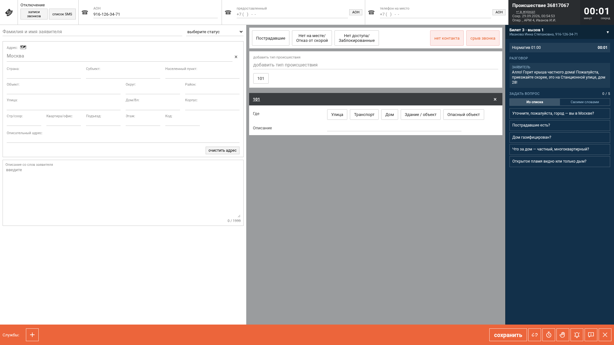

*Рис. 5. Опросная карта пожара (101). Вопросы появляются по мере
ответов, как в рабочем месте оператора.*

В карточке можно выбрать несколько типов происшествия — из списка или
быстрыми плашками; у каждого своя опросная карта, и все уровни признаков
доходят до позиции классификатора. Службы подбираются классификатором,
добавить вручную можно из окна «Добавьте службы».

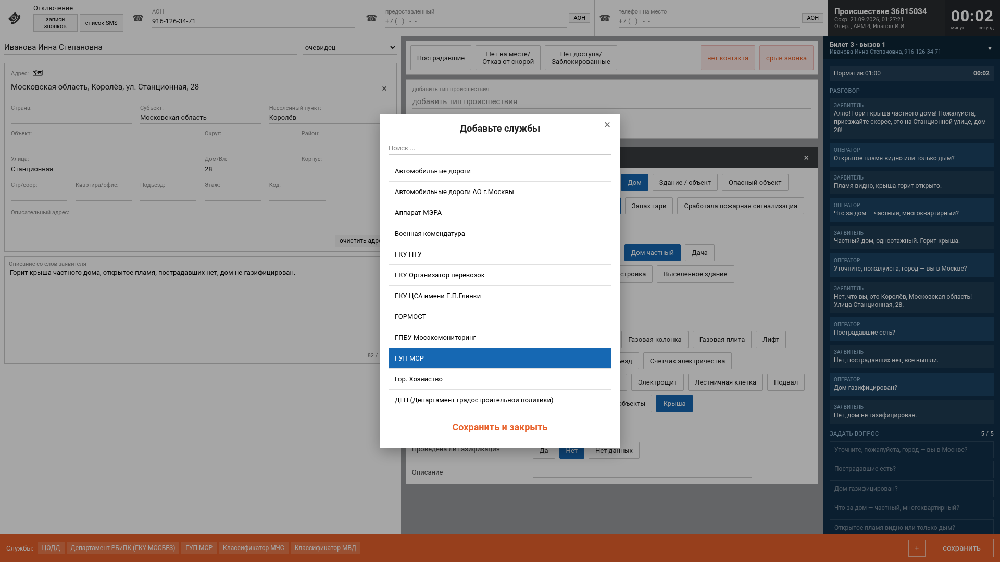

*Рис. 6. Окно «Добавьте службы»: 211 служб в привычном порядке.*

После сохранения курсант сразу видит разбор правил; анализ текста
нейросетью приходит следом.

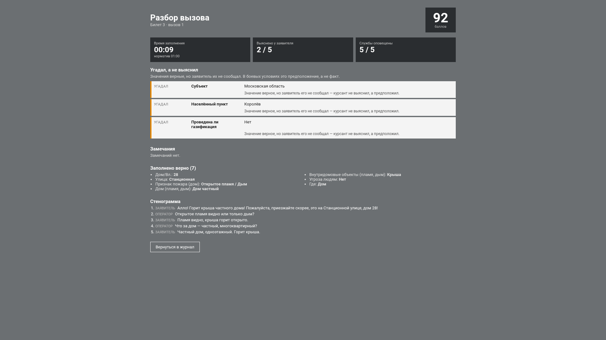

*Рис. 7. Разбор вызова 112: замечания по полям, «выяснил или угадал»,
прогноз и рекомендации.*

### 3.2. Диспетчер ДДС

Диспетчеру приходят только учебные происшествия, выданные
преподавателем, — готовые карточки 112, которые преподаватель собрал
сам или по описанию моделью и утвердил. Карточки курсантов 112
к диспетчеру не попадают. Диспетчер работает с несколькими карточками
одновременно: пока он занят одной, время идёт и у ожидающих.

```
карточка в строке сообщений ─(30 с)─► открыта ─(3 мин)─► первая запись
      │                                                     │
      │                         «Принята» ─► назначить бригаду
      │                                           │
      │                 доклады старшего / звонок старшему
      │                                           │
      └──► «Не принята» с причиной     статусы по факту ─► «Работы завершены»
                                                  │
                                              разбор ДДС
```

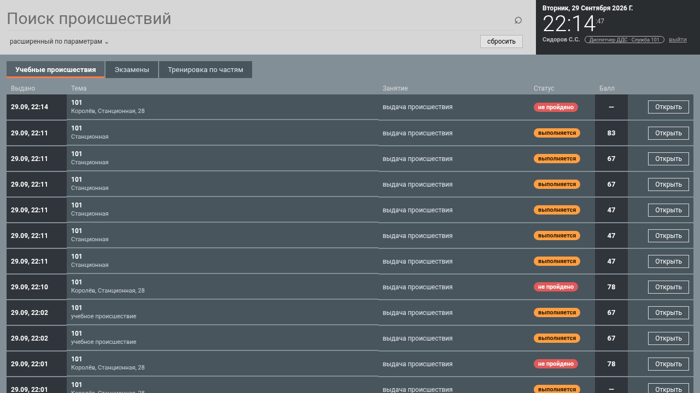

*Рис. 8. Разделы диспетчера ДДС и лента выданных происшествий.*

**Статусы реагирования** идут строго по памятке ДДС: «Принята» или
«Не принята», затем «Начало реагирования» → «Прибытие» → «Проведение
работ» → «Работы завершены» или «Отказ от выполнения работ». Порядок
проверяется на сервере. «Не принята» и «Отказ» без комментария сервер
не принимает. Поля, заполненные оператором 112, диспетчер не редактирует.

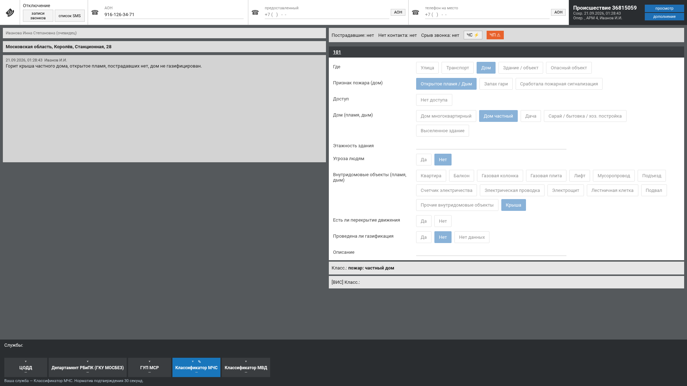

*Рис. 9. Карточка ДДС: поля 112 только для чтения, свои статусы
и комментарии.*

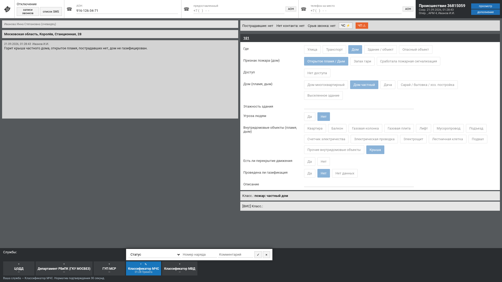

*Рис. 10. Выбор статуса: предлагаются только допустимые по порядку.*

**Нормативы:** открыть карточку — 30 с с момента появления, первая запись
(статус и текст) — 3 мин. Статус карточки выводится из состояния служб
и прошедшего времени; фоновая задача раз в 5 с переводит просроченные
карточки в «Не оповещено», а через 48 часов — в «Не завершено».

**Бригада.** Диспетчер выбирает бригаду вручную. Этапы работ наступают
по шкале от момента назначения — это скрытая истина, как факты
заявителя у оператора 112. Старший докладывает о наступившем этапе
с задержкой; диспетчер, который позвонил раньше, узнаёт раньше. Доклад
называет только этап («прибыли на место»), обстановку на месте тренажёр
не выдумывает. Число учебных бригад (3), шкала этапов, задержка доклада
и норматив обновления статуса вынесены в настройки.

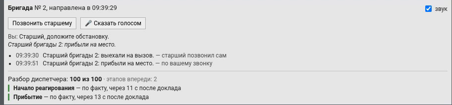

*Рис. 11. Панель бригады: назначение, звонок старшему, доклады.*

**Доклад начальнику.** Диспетчер звонит из карточки и докладывает:
что случилось, где, пострадавшие, кого оповестили, какая бригада и на
каком этапе. Начальник переспрашивает о каждом сведении, которого не
услышал или которое расходится с карточкой, и говорит «Принял».
Говорить можно голосом или текстом. Разбор доклада — отдельный блок
в разборе попытки: по каждому сведению «доложено», «не доложено» или
«доложено неверно» с дословной фразой диспетчера. Балл он не меняет —
решение за преподавателем.

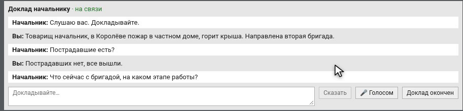

*Рис. 12. Звонок вышестоящему начальнику из карточки ДДС.*

### 3.3. Преподаватель

**Учебный материал** — вкладки «Вызовы 112» и «Происшествия ДДС».
Материал создаётся тремя путями: по описанию (преподаватель пишет
словами, что произошло, модель готовит черновик по строгой схеме),
вручную (форма из тех же виджетов, что карточка 112) и из билетов
(конвейер подготовки, раздел 5.1). Службы и итоговый тип в эталоне
всегда считает классификатор, а не модель.

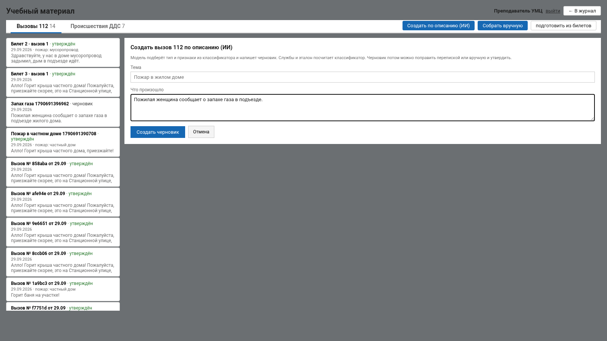

*Рис. 13. Подготовка учебного вызова по описанию: черновик модели,
который преподаватель правит и утверждает.*

Вызов 112 доводится перепиской с моделью: «поменяй ФИО», «сделай
первую фразу короче». Правка применяется к вызову, эталон
пересчитывается классификатором, в переписке показывается, что
изменилось фактически — по сравнению вызова до и после. Поправки
преподавателя идут в контекст модели: последние ходы переписки подаются
ей при следующей правке того же вызова. До утверждения материал не
виден ни курсантам, ни при составлении занятия. Преподаватель —
конечный валидатор.

**Занятия.** Преподаватель создаёт занятие для группы, выбирает режим
и материал, запускает, следит за ходом и завершает. В режиме ДДС
карточки поступают потоком с заданным интервалом.

| Вид | Что это | Правила |
|---|---|---|
| **Обычное** | учебные вызовы или происшествия по выбранным темам | разбор сразу после каждого вызова |
| **Марафон** (экзамен) | 5–10 вызовов | строго по порядку, одна попытка; разбор и балл открываются после последнего вызова |
| **Блиц** («Тренировка по частям») | 3–10 коротких заданий на один сегмент карточки | сегмент — адрес, тип с опросной картой или службы; у ДДС — статусы; в балл идут только поля сегмента |

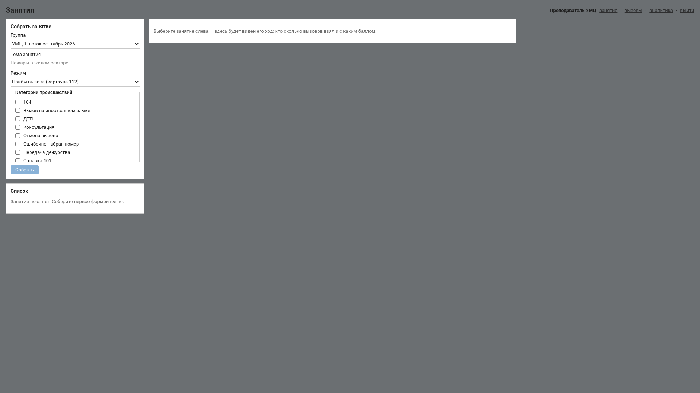

*Рис. 14. Занятия преподавателя: создание, запуск, ход по местам,
протокол.*

**Ход занятия по местам** — страница идущего занятия: время, число
мест, кто опаздывает, «не оповещено», отказы. У каждого места ФИО,
текущая карточка, крупный таймер против норматива, ход заполнения.
Обновление раз в 2,5 с, есть режим проектора. **Итоговый протокол** —
по каждому курсанту: вызовы, балл, время, грубые ошибки, экспертная
оценка.

**Экспертная оценка.** В карточке, открытой из журнала, преподаватель
видит все попытки по ней и ставит балл 0–100 с комментарием.
Автоматический балл не переписывается: оба хранятся и показываются
рядом. Каждая оценка пишется в журнал действий.

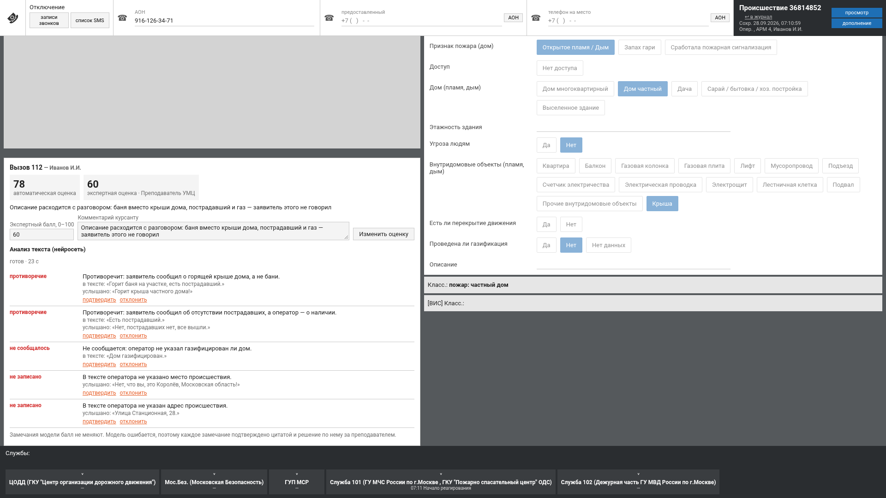

*Рис. 15. Экспертная оценка рядом с автоматической.*

**Аналитика** — по группе и по ученику, отдельно для 112 и ДДС:
средний балл, время против норматива, лидеры и отстающие, типичные
ошибки, тепловая карта «ученик × группа проверок», прогноз против
факта. Диаграммы построены средствами SVG. Словесную сводку по группе
формулирует модель, но числа в неё подаются уже посчитанными.

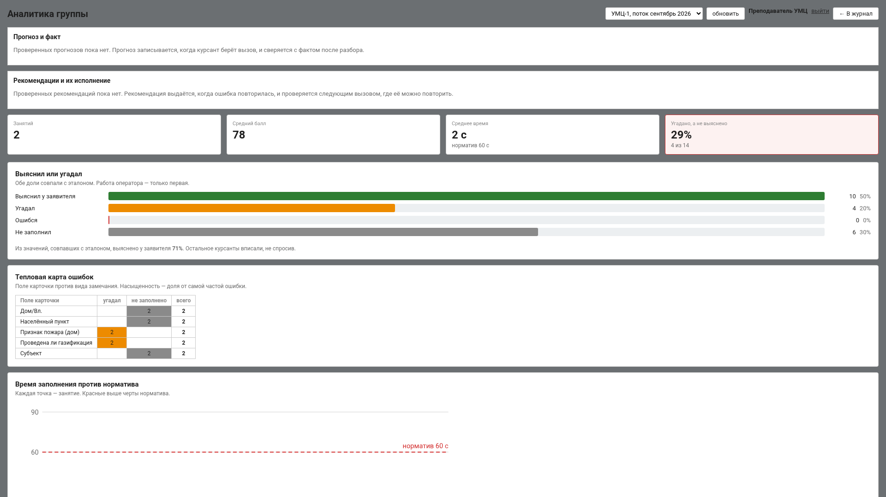

*Рис. 16. Аналитика по группе: тепловая карта ошибок, динамика,
достоверность прогноза.*

### 3.4. Администратор

Администратор заводит, отключает и удаляет учётные записи, загружает
и активирует версии классификатора, меняет параметры и смотрит
системные журналы. Запись с историей перед удалением копируется
в `user_backups` и обезличивается: оценки, карточки и журнал действий
остаются читаемыми. Свою запись и последнего администратора удалить
нельзя. Разницу между версиями классификатора и затронутые учебные
вызовы отдаёт API (`/api/classifier/versions/{a}/diff/{b}`, `…/impact`).


*Рис. 17. Раздел администратора: версии классификатора, пользователи,
параметры.*

### 3.5. Мобильный экран

Интерфейс работает и на телефоне: журнал, карточки и разбор
перестраиваются под узкий экран.

<p>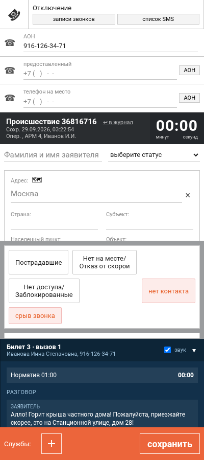 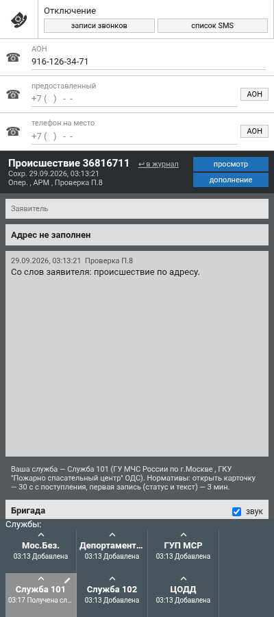 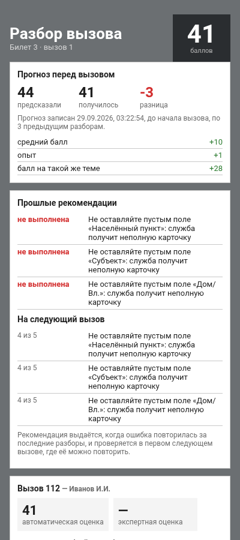</p>

*Рис. 18. Карточка 112, карточка ДДС и разбор на экране телефона.*

---

## 4. Как оценивается курсант

### 4.1. Три слоя данных

| Слой | Что это |
|---|---|
| **Скрытая истина** | что на самом деле произошло, заложено в сценарий |
| **Стенограмма** | что заявитель действительно сообщил |
| **Карточка** | что оператор ввёл в поля |

Из сопоставления рождаются четыре вида замечаний:

| Вид | Вес | Смысл |
|---|---|---|
| `guessed` | 1 | значение верное, но заявитель его не сообщал — угадал |
| `extra` | 1 | вызвана лишняя служба |
| `missing` | 2 | служба не оповещена |
| `wrong` | 3 | значение не совпало с эталоном |

Превышение норматива времени добавляет 2. Замечание формулируется как
последствие: не «−3 за поле „служба“», а «служба не оповещена —
фактически не выехала».

### 4.2. Проверки диспетчера ДДС

| Замечание | Вес | Смысл |
|---|---|---|
| статус раньше доклада | 2 | «не по факту» — аналог «угадал» |
| доклад без статуса | 2 | служба 112 и соседние ДДС не видят хода работ |
| принята, бригада не назначена | 2 | на место никто не выехал |
| статус позже доклада сверх норматива | 1 | в карточке устаревшая картина |
| карточка открыта позже 30 с | 1 | норматив открытия |
| первая запись позже 3 мин или без текста | 1 | норматив первой записи |

### 4.3. Веса оценки

Каждое замечание разбора — проверка: «верно» засчитывается целиком,
«угадал» и «лишняя служба» — на две трети, «не заполнено» — на треть,
«неверно» — ноль. Проверки разложены по семи группам с весом 0–5:

| Группа | Что входит |
|---|---|
| Время | 30 с на открытие, 3 мин на первую запись, норматив набора карточки 112 |
| Порядок статусов | статусы по порядку и по докладам бригады |
| Комментарии | причина «Не принята» и «Отказа», кому передано |
| Адрес | улица, дом и прочие поля адреса |
| Тип происшествия и службы | тип, итоговый тип, службы оповещения |
| Полнота карточки | признаки опросной карты, пострадавшие, «сказал ↔ заполнил» |
| Понятность текста | замечания нейросетевого анализа ручного ввода |

**Балл = Σ (вес группы × зачёт проверки) / Σ весов.** По умолчанию все
веса 3, «понятность текста» — 0: модель без решения преподавателя балл
не меняет. Критичная ошибка — похожая, но другая улица («Дубнинская»
вместо «Дубининской») — ограничивает балл 40 из 100. Ползунки на
странице «Веса оценки» пересчитывают баллы всех попыток до сохранения:
видно «средний балл было → стало» и сколько попыток изменят балл.

### 4.4. Нейросетевой анализ текста

Всё, что проверяется сравнением, проверяют правила. Свободный текст
читает модель: у оператора 112 — «Описание со слов заявителя» против
стенограммы, у диспетчера ДДС — комментарии к статусам против карточки
и докладов бригады.

Модель не ищет расхождения сама — модель такого размера их пропускает.
Она разбирает текст курсанта по утверждениям и про каждое отвечает:
подтверждается, противоречит или заявитель этого не сообщал; отдельно —
что существенное заявитель сказал, а в тексте нет. Каждое замечание
подтверждено цитатой, и цитату проверяет код: не нашлась в тексте
курсанта или стенограмме — замечание отбрасывается. Так модель не может
приписать курсанту или заявителю чужие слова.

Балл модель не меняет. Замечания стоят отдельным блоком «Анализ текста
(нейросеть)» со статусом; преподаватель подтверждает или отклоняет
каждое. Модели нет — блок честно помечается «модель недоступна».

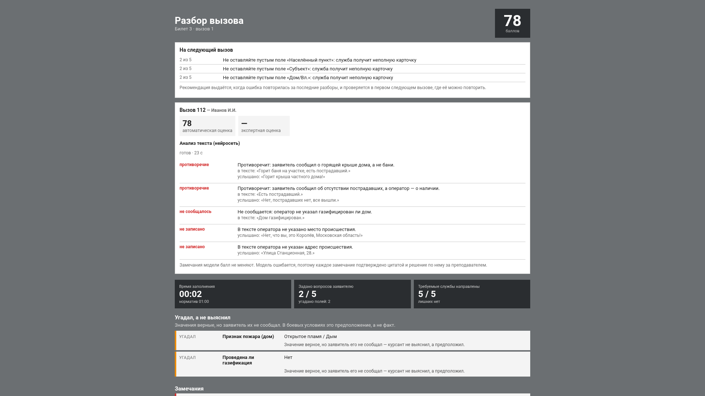

*Рис. 19. Блок анализа текста: замечания модели с цитатами, вердикт
преподавателя.*

На процессоре описание 112 сверяет кросс-энкодер OpenJEV: описание —
посылка, факт вызова — гипотеза, ответ «подтверждает / противоречит /
молчит» одним проходом, без генерации. Для этого языковая модель при
подготовке вызова переписывает ответы заявителя утверждениями («Дом не
газифицирован» вместо «Нет, дом не газифицирован»), преподаватель видит
и правит их рядом с ответами.

| Сверка на процессоре | Верно | Ложных «противоречит» | С на описание |
|---|---|---|---|
| OpenJEV 4B | 45 из 49 (92 %) | 1 | 3,4 |
| OpenJEV 2B | 39 из 49 (80 %) | 5 | 1,4 |
| GigaChat 3.1 (66 пар) | 48 из 66 (73 %) | 1 | 10,4 |

Чекпоинт по умолчанию — 2B (9 ГБ памяти против 18 ГБ у 4B). Подробно —
`backend/docs/замеры/ОПИСАНИЯ.md`.

### 4.5. Прогноз результата

Прогноз фиксируется до начала вызова и задним числом не переписывается;
факт проставляется после разбора. Модель — гребневая регрессия: данных
мало, сложная модель переобучится, а на разборе нужно показать, из чего
сложился прогноз. Признаки — средний балл, тренд, доля угаданного, доля
превышений норматива, опыт, средний балл на той же группе
классификатора. Рядом всегда базовая линия — средний балл курсанта.
Пока пар «прогноз — факт» меньше 30, прогноз делает базовая линия.
Достоверность — средняя абсолютная ошибка и доля попаданий в допуск
(±10 баллов), и та же ошибка у базовой линии.

### 4.6. Рекомендации

После разбора система ищет повторяющиеся ошибки: одно и то же поле
с тем же видом замечания в последних разборах (окно 5 разборов, повтор
не меньше 2 раз, открытых рекомендаций не больше 3). Текст собирается
из замечаний разбора, модель его не пишет. В первом следующем разборе,
где ошибка могла повториться, ставится вердикт: ушла или нет. Доля
сработавших — измеренная величина, рядом базовая линия: как часто та же
ошибка уходит сама.

Прогноз и рекомендации проверены на группе ИИ-агентов, проходивших
учебные вызовы на стенде.

---

## 5. ИИ и голос

### 5.1. Языковая модель

Модель отвечает за то, что нельзя посчитать: черновики учебных вызовов,
правку по переписке, сводки, анализ текста. Эталон для оценки она не
считает никогда. Конвейер подготовки вызова:

1. признаки выбираются из закрытого словаря опросной карты;
2. ответы, которых нет в словаре, отбрасываются;
3. классификатор считает эталон;
4. его замечание («уточните признак второго уровня») возвращается
   модели, шаг повторяется;
5. только после этого модель пишет текст легенды и скрытых фактов.

Ответ ограничен схемой JSON на уровне декодирования
(`response_format: json_schema`): структурно неверный ответ невозможен.

Во время вызова модель работает в двух местах. **Свободный вопрос
заявителю:** задача закрытая — вопрос либо про один из скрытых фактов,
либо ни про какой; модель выбирает факт из перечисления, заданного
схемой. Заявитель отвечает записанным в сценарии, вопрос ни про что
получает «Не поняла вас, повторите». Нет модели — вопрос понимается
по совпадению слов. **Живая речь заявителя** (профиль GPU,
`applicant.live_model = 1`): модель пересказывает ответ сценария своими
словами и с волнением, видя только раскрытые факты; реплика проверяется
до показа (числа — кодом, суть — вторым запросом), иначе звучит
заготовка.

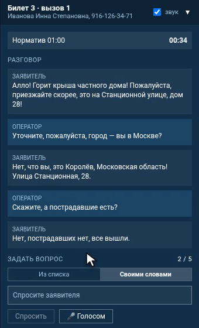

*Рис. 20. Вопрос заявителю своими словами или голосом.*

Замер свободного вопроса (34 вопроса, 7 нарочно не по делу):

| Модель | Понят верно | «Нечего отвечать» | Медиана |
|---|---|---|---|
| ЦП: GigaChat 3.1, 6 потоков | 27 из 27 | 5 из 7 | 1,74 с |
| GPU: Qwen3.8-27B, RTX 4090 | 27 из 27 | 6 из 7 | 0,35 с |

### 5.2. Голос

Распознавание — GigaAM v3 e2e RNNT (с пунктуацией), синтез — TeraTTSv2.
Обе модели в ONNX, на процессоре. Старший бригады и начальник звучат
разными голосами, заявитель — мужским или женским по отчеству из
сценария; все через телефонный тракт (300–3400 Гц, μ-law). Голос роли
меняется переменной `VOICE_STYLES`.

Что говорит собеседник, решает движок тренажёра, а не модель: голос
лишь произносит. Скорость (4 потока): синтез фразы 0,5–0,7 с на 3–5 с
звука, распознавание 0,2–0,3 с. Повторная фраза берётся из кэша. Без
сервера голоса всё работает текстом.

### 5.3. Профили CPU и GPU

Целевой стенд — процессор не менее 6 ядер, 32 ГБ памяти, без
видеокарты. Выбрана **GigaChat 3.1 10B-A1.8B**: из десяти миллиардов
параметров на каждом токене работают 1,8 миллиарда, поэтому модель
отвечает как небольшая, а знает как крупная. Лицензия MIT. Включено
спекулятивное декодирование на встроенном блоке MTP; поддержки в
llama.cpp не было, она добавлена двумя патчами из поставки
(`backend/docs/mtp-*.patch`). Результат на 6 потоках: 10,3 → 14,8
токенов в секунду, прирост 44 %. Мерили на AMD EPYC 7532 с восьмиканальной
памятью — это потолок: на настольном i7 будет ниже.

Если есть видеокарта, меняется одна переменная — `ML_BASE_URL`. Проверено
на RTX 4090 под vLLM (`deploy/gpu/start-vllm.sh`), обе модели Apache 2.0:
Gemma 4 26B-A4B (INT4, выбрана по умолчанию) и Qwen3.8-27B (INT4).

| Задача | ЦП: GigaChat 3.1 | GPU: Qwen3.8-27B | GPU: Gemma 4 26B-A4B |
|---|---|---|---|
| генерация, токенов/с | 14,8 | 54 | 170 |
| подготовка вызова по билету | 94 с | 7 с | 3 с |
| анализ описания курсанта | 26–33 с | 7,6 с | 2,3 с |
| разбор доклада начальнику | 20,8 с | 5,4 с | 1,3 с |
| сверка описания, 66 пар | 73 %, 10,4 с | 92 %, 1,1 с | 94 %, 0,45 с |
| свободный вопрос (понято / отсеяно) | 27 / 5, 1,7 с | 27 / 6, 0,35 с | 27 / 7, 0,13 с |
| живая реплика заявителя | 8,3 с — непригодно | 17 из 19, 1,6 с | 16 из 19, 0,5 с |

На GPU включаются модель в разговоре с начальником (`chief.live_model`)
и живая речь заявителя; на процессоре начальник переспрашивает по
ключевым словам, модель разбирает доклад один раз после «Принял»
(около 20 с в фоне), заявитель говорит фразами сценария.

### 5.4. Закрытый контур

Все компоненты работают на одной машине без выхода в интернет. Сервер
приложения обращается к модели по протоколу, совместимому с OpenAI API,
по адресу `ML_BASE_URL`; тот же адрес можно направить на любой
совместимый сервер внутреннего контура (vLLM, Ollama), не меняя кода.
Данные никуда не уходят.

---

## 6. Замеры

Замер 28.09.2026 на release-сборке. Сервер и PostgreSQL ограничены
6 физическими ядрами и 32 ГБ. Языковая модель выключена: во время
занятия она нужна только для свободного вопроса. Методика, сырые данные
и скрипт — `backend/docs/замеры/НАГРУЗКА.md`.

| Требование | Измерено | Условия |
|---|---|---|
| отклик ≤ 2 с при 100 пользователях | максимум 0,69 с, p99 0,18 с; без пауз (1783 запроса/с) — максимум 0,61 с; ошибок 0 | 80 курсантов и 20 преподавателей, 60 с |
| не менее 20 сессий | 50 вызовов, начатых в одну секунду, — все дошли до разбора, 0,62–0,64 с на вызов; 80 разом — до 2,2 с | вызов целиком: вход, начало, пять вопросов, правка, сохранение |
| сбой сети до 30 с | правки в базе через 0,1 с после возврата сети; канал событий открыт через 0,1 с | e2e-тест `сбой-сети.spec.ts`, три прогона из трёх |
| запись ≥ 100 операций/с | 1516 правок карточки в секунду, p99 41 мс | 50 потоков, 20 с |
| отчёт ≤ 30 с | отчёт по группе 0,56–0,71 с; по вызову 7–11 мс | 5380 карточек в базе |
| VoIP ≤ 150 мс | не измерялась: телефонии (SIP) нет, голос — программная эмуляция | распознавание 0,2–0,3 с, синтез 0,5–0,7 с |

Что нашёл замер и что исправлено: обучение прогноза при каждом начале
вызова (p99 2,45 с) вынесено в фон, раз в минуту — p99 0,19 с; журнал
диспетчера с 135 мс до 16 мс; канал событий после обрыва переподключается
сразу. Не мерились: модель под нагрузкой, настольный процессор.

---

## 7. Развёртывание и запуск

### 7.1. Стенд одной командой

```bash
deploy/up.sh
```

| Сервис | Что это | Наружу |
|---|---|---|
| `web` | nginx: клиент, прокси `/api` и `/ws` | порт 80 |
| `backend` | сервер тренажёра, release-сборка; ежесуточная копия базы | нет |
| `db` | PostgreSQL 16 | нет |
| `model` | llama.cpp с патчем MTP и весами GigaChat | нет |

При первом запуске скрипт создаёт `deploy/.env` со случайными паролем
базы и ключом подписи токенов; сервер накатывает миграции и импортирует
классификатор. Модель включается, только если найден файл весов.
Проверка стенда — `deploy/check.sh`. Требования к ВМ: 6 ядер x86-64,
32 ГБ памяти с моделью (16 ГБ без неё), 40 ГБ диска, Ubuntu 22.04
или 24.04. Подробно — `deploy/README.md`.

### 7.2. Локальный запуск

| Компонент | Версия | Проверено на |
|---|---|---|
| Rust | 2021 edition | 1.98.1 |
| Node.js | 20.19+ | 20.20.0 |
| PostgreSQL | 14+ | 16 |
| Docker | любая | для базы, необязателен |

```bash
# база
docker run -d --name arm112-db -e POSTGRES_USER=arm112 \
  -e POSTGRES_PASSWORD=arm112 -e POSTGRES_DB=arm112 -p 5432:5432 postgres:16

# сервер: http://localhost:8080, миграции накатываются сами
cd backend && cp .env.example .env && cargo run --release

# классификатор — один раз, затем перезапустить сервер
cargo run --release --bin import_classifier -- \
  ../task/Классификатор_происшествий_v_046_24*.xlsx "v046_24"

# клиент: сборка в apps/react/dist или dev-сервер на :5173
cd frontend && npm run install:all && npm run build   # или npm run dev
```

Учётные записи учебного набора: `admin`, `teacher1`, `op01`…`op10`,
`dds01`…`dds10`, пароль `arm112`. Стенд наполняется скриптом
`deploy/seed/залить.py` (очищает учебные данные, снимите копию базы):
20 вызовов 112 и 20 происшествий ДДС по 10 темам, по 2 экзамена
и 2 тренировки для каждой роли.

### 7.3. Сервер модели

```bash
llama-server -m GigaChat3.1-10B-A1.8B-q4_K_M.gguf \
  --host 127.0.0.1 --port 8090 -t 6 -c 8192 \
  --spec-type draft-mtp --spec-draft-n-max 1
```

Подробная процедура с патчами — `backend/docs/MODEL-SERVER.md`. Без
модели сервер работает на заглушке: журнал, карточки, классификация,
занятия, оценка, прогноз и рекомендации работают; нет подготовки вызовов
моделью, сводки и анализа текста (он помечается «модель недоступна»).

### 7.4. Серверы голоса и сверки

Оба необязательны.

```bash
# голос: веса istupakov/gigaam-v3-onnx и TeraSpace/TeraTTSv2
python3 -m venv .venv-voice && .venv-voice/bin/pip install -r voice/requirements.txt
cd voice && VOICE_MODELS_DIR=/путь/к/голосу VOICE_THREADS=4 \
  ../.venv-voice/bin/uvicorn server:app --host 127.0.0.1 --port 8091

# сверка: чекпоинт AlexWortega/openjev, qwen3.5-2b-nli-v5
python3 -m venv .venv-nli
.venv-nli/bin/pip install torch --index-url https://download.pytorch.org/whl/cpu
.venv-nli/bin/pip install -r nli/requirements.txt
cd nli && NLI_MODEL_DIR=/путь/к/qwen3.5-2b-nli-v5 NLI_THREADS=6 \
  ../.venv-nli/bin/uvicorn server:app --host 127.0.0.1 --port 8093
```

### 7.5. Переменные окружения

| Переменная | Назначение |
|---|---|
| `DATABASE_URL` | подключение к PostgreSQL |
| `TEST_DATABASE_URL` | отдельная база для проверок |
| `ML_PROVIDER` | `http` — сервер модели, `mock` — заглушка |
| `ML_BASE_URL` | адрес сервера модели (llama.cpp, vLLM, Ollama) |
| `VOICE_BASE_URL` | адрес сервера голоса |
| `VOICE_MODELS_DIR`, `VOICE_THREADS`, `VOICE_STYLES` | веса, потоки и голоса ролей для сервера голоса |
| `NLI_BASE_URL` | адрес сервера сверки |
| `NLI_MODEL_DIR`, `NLI_THREADS` | чекпоинт и потоки сервера сверки |

Нормативы, параметры прогноза, рекомендаций и шкалы бригады хранятся
в таблице настроек. Администратор меняет их на вкладке «Параметры» или
через `PATCH /api/settings/{key}`; у каждого параметра есть допустимые
пределы.

---

## 8. API и интеграция

Описание API — `http://<стенд>/api/docs` (OpenAPI). Основные маршруты:

| Маршрут | Назначение |
|---|---|
| `GET /api/me/work?section=training\|exam\|blitz` | разделы курсанта |
| `POST /api/sessions/{id}/ask-free` | свободный вопрос заявителю |
| `POST /api/voice/asr`, `POST /api/voice/tts`, `GET /api/voice/status` | голос |
| `GET /api/lessons/{id}/monitor`, `…/protocol` | ход занятия и протокол |
| `GET /api/analytics/groups/{id}?duty=op112\|dds`, `…/students/{id}` | аналитика |
| `POST /api/grading/weights/preview`, `PUT /api/grading/weights` | веса оценки |
| `PATCH /api/settings/{key}` | параметры |
| `GET /api/classifier/versions/{a}/diff/{b}`, `…/impact` | версии классификатора |

Отчёт по занятию отдаётся в JSON и CSV. Встраивание в стороннюю систему
описано в `INTEGRATION.md`, схема базы и контракт API — в `BACKEND.md`.
Каждая оценка, вердикт по замечанию модели, смена профиля и удаление
записи пишутся в журнал действий.

---

## 9. Качество и проверки

```bash
cd backend && cargo test                             # 400 проверок
cd frontend/e2e && npx playwright install chromium   # один раз
cd frontend && npm test                              # 102 сценария в браузере
cd backend && cargo test --test text_analysis -- --ignored --nocapture  # с настоящей моделью
```

Проверки работают на отдельной базе, браузерный прогон поднимает свой
сервер и клиент на своих портах. Проверено на настоящей модели: на
нарочно испорченном описании вызова «горит крыша частного дома» модель
нашла все четыре расхождения за 26–33 с на процессоре.

Все данные тренажёра взяты из материалов задачи, их происхождение
построчно зафиксировано в `PROVENANCE.md`: две версии классификатора,
96 обращений из 32 билетов, интерфейс по кадрам рабочего места. Где
данных не хватило, параметр вынесен в настройки и помечен как допущение.

### Библиотеки и лицензии

Сервер: tokio, axum, sqlx, serde, argon2, jsonwebtoken, reqwest,
tokio-tungstenite, utoipa, calamine — все MIT и/или Apache-2.0. Полный
граф 344 пакета, копилефт-лицензий нет. Клиент: react 19, react-router,
zustand, vite, sass (MIT), typescript (Apache-2.0). Модели: GigaChat 3.1
и llama.cpp — MIT, GigaAM v3 — MIT, OpenJEV — MIT, Gemma 4 и Qwen3.8 —
Apache 2.0. Лицензия MIT у весов разрешает коммерческое использование.
Полные версии — `backend/Cargo.lock`, `frontend/apps/react/package-lock.json`.

---

## 10. Развитие

Что сделано не полностью и куда двигаться дальше:

* **Территориальные службы.** Службы подбираются по типу происшествия;
  районные ДДС, префектуры и подчинённые объекты добавляются вручную.
* **Дообучение по правкам преподавателя.** Правки идут в контекст
  модели при следующей правке того же вызова; веса модели не меняются.
* **Анализ текста не сверен с экспертами на выборке.** Проверен на
  отдельных вызовах, поэтому балл не меняет, решение за преподавателем.
* **Телефонии (SIP) нет** — программная эмуляция в браузере.
* **Сводка по группе на процессоре** считается около минуты.
* **Часть кнопок интерфейса без действия** — оставлены на своих местах,
  чтобы курсант учился на знакомом экране; подсказка так и говорит.
* **Тренажёр не подключается к действующей ПОВ-112** и не предполагает
  обмена с ней.

Все допущения перечислены в `OPEN-QUESTIONS.md` и `PROVENANCE.md`.

### Состав документации репозитория

| Файл | О чём |
|---|---|
| `README.md` | обзор, быстрый старт |
| `deploy/README.md` | развёртывание стенда, эксплуатация |
| `BACKEND.md` | схема базы, контракт API, домен |
| `INTEGRATION.md` | встраивание в стороннюю систему |
| `PROVENANCE.md` | происхождение данных и допущения |
| `OPEN-QUESTIONS.md` | открытые вопросы и принятые допущения |
| `backend/docs/MODEL-SERVER.md` | сервер модели, замеры |
| `backend/docs/замеры/` | нагрузка, голос, описания, свободный вопрос |
| `frontend/README.md`, `frontend/SCENARIOS.md` | клиент, сопоставление экранов |
